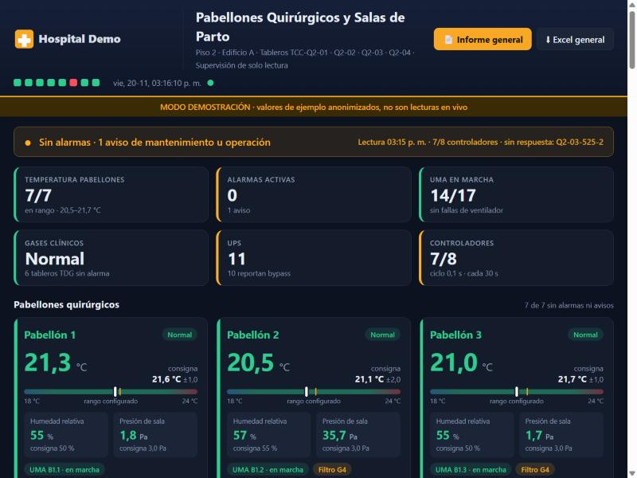

# Surgical Suite BMS Monitor

**Read-only BACnet/IP dashboard for operating rooms and delivery rooms: HVAC (AHUs), room pressure, medical gases, UPS and CO₂, plus printable technical reports and Excel exports.**



> 🇪🇸 Versión **anonimizada** de un sistema que hice y que funciona en un hospital público de Chile. Los nombres, las IP, el firmware y los datos del recinto se reemplazaron; las IP usan el rango de documentación `192.0.2.0/24` (RFC 5737). Los valores de la demo son de ejemplo.

## Qué resuelve

El BMS (Sauter, BACnet/IP) de un piso quirúrgico tiene casi mil puntos repartidos en 8 controladores, y su interfaz no daba al equipo de mantenimiento una vista por sala ni informes. Este dashboard:

- Lee en paralelo **8 controladores y unos 970 puntos** cada 30 s, solo con `ReadProperty`: **nunca escribe en un PLC**.
- Muestra por **pabellón y sala de parto** la temperatura con su consigna y banda, la humedad, la presión de sala y el estado de la UMA, con tendencia de 24 h.
- Agrupa **17 UMA**, **gases clínicos** (O₂, aire, vacío, N₂ × 6 tableros), **11 UPS**, CO₂, equipos de precisión y extractores.
- Confirma las **alarmas en dos ciclos** antes de avisar y congela (no da por normalizadas) las alarmas de un controlador que deja de responder.
- Detecta **lecturas físicamente imposibles** (por ejemplo −60 °C o 0,1 % HR) y las marca como falla de sensor en vez de evaluarlas.
- Genera un **informe técnico A4** (HTML imprimible a PDF) y un **Excel** con historial, estadísticas, % del tiempo en rango, eventos y una planilla de rondas para contrastar el BMS con un instrumento.

## Cómo está hecho

| Parte | Detalle |
|---|---|
| Protocolo | Cliente **BACnet/IP sobre UDP crudo** (`pabellones/bacnet.py`), sin dependencias |
| Descubrimiento | `herramientas/descubrir.py` lee el `object-list` de cada controlador; `generar_puntos.py` clasifica ~1.000 objetos por nombre con reglas y correcciones explícitas |
| Modelo | `monitor.py`: sondeo, caché, histéresis de alarmas, SQLite con retención configurable |
| Servidor | `http.server` de la biblioteca estándar, API JSON, un solo proceso |
| Frontend | HTML + JS sin framework ni CDN: funciona en una red sin internet |
| Excel | `openpyxl` incluido en `vendor/` (MIT): sin `pip` en el PC de destino |
| Pruebas | 13 pruebas `unittest` sin red, con un cliente BACnet simulado |

**Restricciones del entorno real** que guiaron el diseño: un PC de planta sin permisos de administrador, sin internet y con un antivirus corporativo que bloquea `.bat`, `.ps1` y procesos ocultos. Por eso todo arranca con doble clic sobre un `.py`, en una consola visible y con una sola instancia.

## Probarlo

Requiere Python 3.8 o superior. No hay que instalar paquetes.

```bash
python INICIAR_PABELLONES.py --demo
```

Se abre en <http://localhost:8094>. El modo demo no abre sockets hacia ningún PLC.

```bash
python -m unittest discover tests
```

## Seguridad

- Es de solo lectura por diseño: el cliente no implementa `WriteProperty`.
- No hay credenciales en el código. Las IP del recinto viven en `config/`.
- El servidor escucha en `127.0.0.1` por defecto.

## Licencia

MIT. `vendor/` contiene openpyxl y et_xmlfile con sus propias licencias (MIT).
